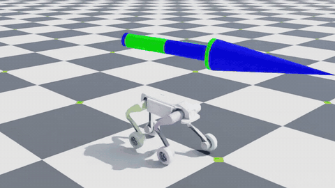
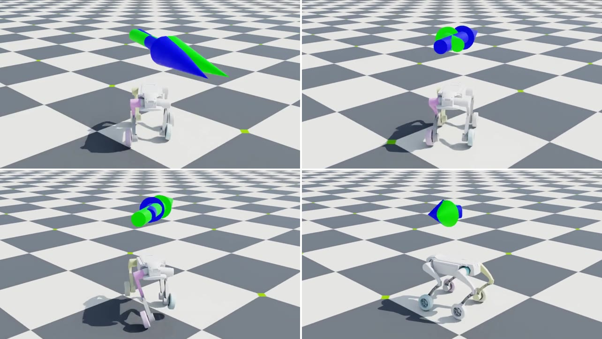
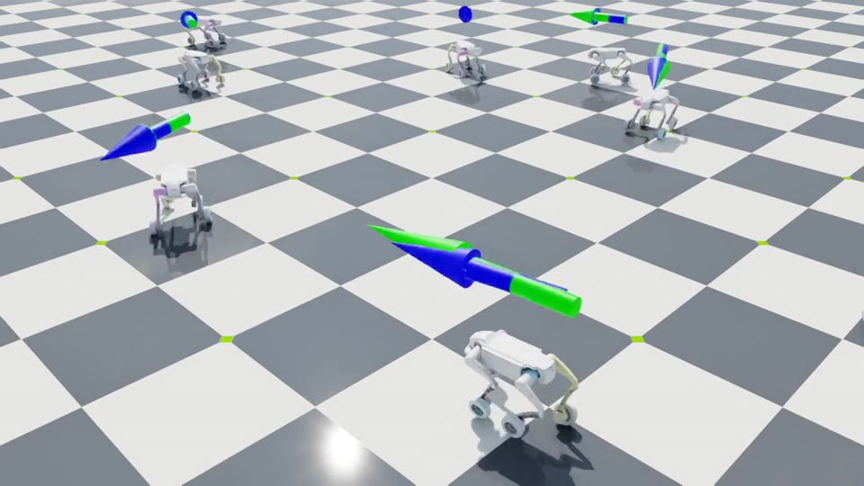

# GENISOM L1-W Wheeled-Legged Locomotion (Isaac Lab 3.0)

Velocity-tracking locomotion for the GENISOM **钢镚 L1-W** (ZSL-1W), a 16-DoF wheeled-legged quadruped
(12 leg joints + 4 wheels), trained with PPO ([rsl_rl](https://github.com/leggedrobotics/rsl_rl)) in
[Isaac Lab](https://github.com/isaac-sim/IsaacLab) 3.0 on Isaac Sim 6.1.

The policy is blind (proprioception only) and is built for the abrupt, discrete velocity commands of a reactive
avoidance layer: forward ±1 / ±2 m/s, sideways ±0.4 / ±0.8 m/s, yaw rate up to ±1.5 rad/s, with instant stops,
reversals and lateral jumps.

<p align="center">
  
  <br>
  <sub>v2.2 policy in Isaac Sim 6.1, random evasive commands (green arrow: command, blue arrow: measured base velocity).
  Full 30 s clip: <a href="docs/media/showcase_v2.2.mp4">docs/media/showcase_v2.2.mp4</a></sub>
</p>

- **Asymmetric actor-critic.** The actor sees a 10-frame history of 57-d proprioception (570 inputs) and no base
  linear velocity: the history is the velocity estimator. The critic gets a single privileged 60-d frame.
- **Evasive command generator.** Discrete command sets, short holds (0.1-0.4 s) and emergency patterns
  (stop / reversal / lateral jump) relative to the previous command, instead of one uniform sample per 10 s.
- **Step first, roll later.** Stage 1 brakes the wheels so the robot has to learn to step in every direction; a
  free-wheel policy trained from scratch rolls forward and backward and ignores lateral commands.
- **Sim-to-real.** The v2.0 checkpoint runs on the real robot (the deployment runtime is a separate repository).
- **Self-contained.** Robot USD, URDF and meshes and two pretrained checkpoints are included: install Isaac Lab,
  clone, train or play.

## Results

Both checkpoints in Isaac Sim 6.1 / Isaac Lab 3.0: 64 robots x 60 s (3000 policy steps), seed 777, on the StepFirst
training task (observation noise, pushes and domain randomization on, command curriculum complete). Lower is better.

| Metric | v2.0 `model_4999` | v2.2 `model_9997` |
|---|---|---|
| Standing posture error, sum of \|q - q_default\| over the 12 leg joints, settled (rad) | 0.347 | **0.299** |
| Lateral tracking error \|vy_cmd - vy\| while \|vy_cmd\| >= 0.4 m/s (m/s) | **0.175** | 0.183 |
| Forward tracking error \|vx_cmd - vx\| while \|vx_cmd\| >= 1.0 m/s (m/s) | **0.413** | 0.422 |
| xy tracking error \|\|cmd_xy - v_xy\|\| in the first 0.5 s after a command switch (m/s) | **0.900** | 0.927 |
| xy tracking error \|\|cmd_xy - v_xy\|\|, all samples (m/s) | **0.375** | 0.387 |
| Yaw-rate tracking error (rad/s) | **0.175** | 0.182 |
| Falls | 0 / 192 episodes | 0 / 192 episodes |

Velocities are measured in the base frame. Settled standing samples: zero command (\|\|cmd\|\| < 0.1), at least 1 s
after the switch, \|v_xy\| < 0.2 m/s. The policies were trained with Isaac Lab 2.3.2 / Isaac Sim 5.1; after the
port every metric above is within 6 % of the value measured there.

<p align="center">
  
  
</p>

## Requirements

- Linux, an NVIDIA RTX GPU (developed on an RTX 3090, 24 GB)
- Isaac Lab 3.0.0 with Isaac Sim 6.1.0.0 (pip), Python 3.12, PyTorch 2.11 (CUDA 12.8), rsl-rl-lib 5.4.1

## Installation

```bash
git clone <this repository> genisom-l1w-locomotion
cd genisom-l1w-locomotion

# Isaac Lab 3.0 inside the repository (git-ignored); train.sh activates IsaacLab/.venv when it exists
git clone https://github.com/isaac-sim/IsaacLab.git
cd IsaacLab && git checkout v3.0.0          # Isaac Lab 3.0.0, pins Isaac Sim 6.1.0.0
uv sync --extra isaacsim --extra video      # creates IsaacLab/.venv
cd ..
```

Any other Isaac Lab 3.0 installation works as well: activate it before calling `train.sh` / `train.py`, or point
`ISAACLAB=` at its checkout. Running Isaac Sim requires accepting the NVIDIA Omniverse license; `train.sh` sets
`OMNI_KIT_ACCEPT_EULA=YES`, for `train.py` export it yourself.

## Training

```bash
bash train.sh                                # stage 1 from scratch: StepFirst, 4096 envs, 5000 iterations
DRY_RUN=1 bash train.sh                      # show the full command without running it
```

`train.sh` is `train.py` plus the training hyper-parameters on the command line. Every setting is an environment
variable with the recipe value as default; extra arguments are passed through to `train.py`, which accepts every
option of the official Isaac Lab 3.0 train script (`--video`, `--device`, `--distributed`, `physics=...`,
`env.<field>=...`, `agent.<field>=...`).

| Variable | Default | Meaning |
|---|---|---|
| `TASK` | `Isaac-Velocity-Flat-Genisom-L1W-V2-StepFirst-v0` | task ID (see below) |
| `NUM_ENVS` | `4096` | parallel environments |
| `MAX_ITERATIONS` | `5000` | PPO iterations (24 env steps each) |
| `SEED` | `20261014` | seed |
| `CHECKPOINT` | empty | warm start from an rsl-rl 5.x `model_*.pt` (the iteration counter continues); with `--play` the policy to play |
| `LOG_ROOT` | repository | runs go to `$LOG_ROOT/logs/rsl_rl/genisom_l1w_v2/<date>_<run>/` |
| `ISAACLAB` | `./IsaacLab` | Isaac Lab checkout whose `.venv` is activated |
| `LEARNING_RATE`, `SCHEDULE`, `DESIRED_KL`, `ENTROPY_COEF`, `CLIP_PARAM`, `NUM_LEARNING_EPOCHS`, `NUM_MINI_BATCHES`, `GAMMA`, `LAM`, `VALUE_LOSS_COEF`, `MAX_GRAD_NORM`, `NUM_STEPS_PER_ENV`, `SAVE_INTERVAL` | `1e-3`, `adaptive`, `0.01`, `0.01`, `0.2`, `5`, `4`, `0.99`, `0.95`, `1.0`, `1.0`, `24`, `100` | PPO |
| `DRY_RUN` | `0` | `1` prints the command instead of running it |

Tasks (one per stage; the observation and action interface is identical in all three):

| Task ID | Stage |
|---|---|
| `Isaac-Velocity-Flat-Genisom-L1W-V2-StepFirst-v0` | 1: wheels braked, the robot learns to step; command speed and aggressiveness ramp up over the first ~1000 iterations |
| `Isaac-Velocity-Flat-Genisom-L1W-V2-Rolling-v0` | 2: wheels free, warm-started from stage 1 |
| `Isaac-Velocity-Flat-Genisom-L1W-V2-StepFirst-Stable-v0` | stage-1 fine-tune: attitude first, livelier gait, stronger pushes, standing repair (v2.2) |

How the released checkpoints were made (they were trained with Isaac Lab 2.3.2; running the same commands under
3.0 repeats the recipe, not the exact weights):

```bash
# v2.0: stage 1 from scratch (5000 iterations)
bash train.sh

# v2.1: fine-tune of v2.0 without the standing repair (2500 iterations)
TASK=Isaac-Velocity-Flat-Genisom-L1W-V2-StepFirst-Stable-v0 MAX_ITERATIONS=2500 SEED=20261020 \
  CHECKPOINT=<v2.0 run>/model_4999.pt bash train.sh \
  env.rewards.stand_still.weight=-2.0 env.rewards.joint_pos_penalty.params.stand_still_scale=5.0

# v2.2: fine-tune of v2.1 with the task as it is (2500 iterations)
TASK=Isaac-Velocity-Flat-Genisom-L1W-V2-StepFirst-Stable-v0 MAX_ITERATIONS=2500 SEED=20261021 \
  CHECKPOINT=<v2.1 run>/model_7498.pt bash train.sh

# stage 2 (wheels free) from v2.0, not among the released checkpoints
TASK=Isaac-Velocity-Flat-Genisom-L1W-V2-Rolling-v0 CHECKPOINT=<v2.0 run>/model_4999.pt bash train.sh
```

Stage 1 (5000 iterations, 4096 environments) took about 70 minutes on an RTX 3090 with Isaac Lab 2.3.2.

## Play and export

```bash
bash train.sh --play --num_envs 16 --video --video_length 500                   # v2.2, one 10 s clip, then exit
CHECKPOINT=checkpoints/v2.0_stage1/model_4999.pt bash train.sh --play --video   # another checkpoint
```

With `--play`, `train.sh` passes only `TASK` and `CHECKPOINT` (default: the v2.2 release); the training
hyper-parameters do not apply. Inside an activated Isaac Lab environment the same is
`python train.py --play --task <task> --checkpoint <model_*.pt> ...`. This runs the official Isaac Lab 3.0 play
script: it loads the checkpoint, applies the task's play mode (no pushes, no observation noise, full command range,
50 robots unless `--num_envs`) and exports the actor:

```
logs/play/v2.2_stage1c/
├── model_9997.pt                  copy of the repository checkpoint
├── exported/policy.pt             TorchScript
├── exported/policy.onnx           ONNX graph ...
├── exported/policy.onnx.data      ... and its weights (keep the two files together)
└── videos/play/*.mp4              with --video
```

A checkpoint from `checkpoints/` is copied to `logs/play/<name>/` first so the tracked files stay untouched; for
any other checkpoint the outputs are written next to it, as in the official script. Both released checkpoints are
stage-1 policies (wheels braked), so play them on the StepFirst task (the default `TASK`). Training and play run
headless; without `--video` the play loop runs until Ctrl+C, and a visualizer (for example `--viz kit`) opens a
viewer window.

## Task

Simulation: PhysX, 200 Hz physics, policy at 50 Hz (decimation 4), 20 s episodes, flat ground.

**Policy observation (570 = 57 x 10).** Per frame: base angular velocity (3, x0.25), projected gravity (3),
velocity command (3), joint positions relative to the default posture (16, the four wheel entries are always 0),
joint velocities (16, x0.05), previous action (16). The last 10 frames are stacked per term, oldest first
(`[term1 t-9 ... term1 t, term2 t-9 ...]`). Uniform noise: ±0.2 angular velocity, ±0.05 gravity, ±0.01 joint
position, ±1.5 joint velocity.

**Critic observation (60).** Base linear velocity (3) followed by the 57 policy terms, one frame, noise-free.

**Action (16).** Joint order: front-right, front-left, rear-right, rear-left leg (ABAD, HIP, KNEE each), then the
four wheels in the same leg order (`FAR_*`, `FBL_*`, `RAR_*`, `RBL_*` joints).

| Part | Target | Scale |
|---|---|---|
| 12 leg joints | position, q_default + scale x a | ABAD 0.125, HIP / KNEE 0.25 |
| 4 wheels | velocity, scale x a (rad/s) | 5.0 (StepFirst / Stable: 0, wheels braked with damping 5) |

**Command.** vx from {-2, -1, 0, 1, 2} m/s and vy from {-0.8, -0.4, 0, 0.4, 0.8} m/s drawn independently; yaw rate
uniform in [-1.5, 1.5] rad/s, exactly 0 with probability 0.5; 10 % standing environments. Holds are 0.1-0.4 s with
probability 0.3, otherwise 0.8-3.0 s. With probability 0.3 a new command is an emergency pattern relative to the
previous one: full stop, reversal of vx, or a jump to the maximum lateral speed.

**Rewards** (weights per task; empty = not used):

| Term | Rolling | StepFirst | Stable |
|---|---|---|---|
| `track_lin_vel_xy_exp` (std 0.5) | 3.0 | 3.0 | 3.0 |
| `track_ang_vel_z_exp` (std 0.5) | 1.5 | 1.5 | 1.5 |
| `track_lin_vel_xy_transition` (first 0.5 s after a switch) | 1.0 | 1.0 | 0.5 |
| `track_lin_vel_xy_convergence` | 0.05 | 0.05 | 0.05 |
| `lin_vel_xy_error_l1` | -0.25 | -0.25 | -0.15 |
| `ang_vel_z_error_l1` | -0.1 | -0.1 | -0.1 |
| `upward` | 1.0 | 1.0 | 1.0 |
| `lin_vel_z_l2` | -2.0 | -2.0 | -2.0 |
| `ang_vel_xy_l2` | -0.05 | -0.05 | -0.1 |
| `flat_orientation_l2` | | | -2.5 |
| `joint_torques_l2` (legs) | -2.5e-5 | -2.5e-5 | -2.5e-5 |
| `joint_acc_l2` (legs / wheels) | -2.5e-7 / -2.5e-9 | -2.5e-7 / -2.5e-9 | -2.5e-7 / -2.5e-9 |
| `joint_pos_limits` (legs) | -5.0 | -5.0 | -5.0 |
| `joint_power` (legs) | -2e-5 | -2e-5 | -2e-5 |
| `stand_still` (\|\|cmd\|\| < 0.1) | -2.0 | -2.0 | -3.5 |
| `joint_pos_penalty` (standing scale) | -1.0 (x5) | -1.0 (x5) | -1.0 (x8) |
| `feet_contact_without_cmd` | 0.1 | 0.1 | 0.1 |
| `feet_air_time` | | 0.25 | 0.4 |
| `joint_mirror` (diagonal pairs) | -0.02 | -0.02 | -0.01 |
| `action_rate_l2` | -0.005 | -0.005 | -0.005 |
| `wheel_action_l2` | | -0.01 | -0.01 |
| `undesired_contacts` (all but wheels) | -1.0 | -1.0 | -1.0 |
| `contact_forces` (wheels, > 100 N) | -1.5e-4 | -1.5e-4 | -1.5e-4 |

**Terminations.** Time-out, base contact, tilt above 1.0 rad (Stable: 0.7 rad). Self-righting is not trained.

**Domain randomization.** Friction (static 0.4-1.0, dynamic 0.3-0.9); base mass -1 to +4 kg (the lab robot carries
extra compute and a LiDAR on its back); base center of mass x ±5 cm, y ±3 cm, z 0 to +8 cm; velocity pushes of up
to ±1.0 m/s every 3-6 s (Stable: ±1.5 m/s); random reset position, yaw and base velocity.

## Robot

| | |
|---|---|
| Mass | 20.56 kg (vendor URDF) |
| Legs | thigh 0.200 m, shank 0.214 m (knee to wheel axis), wheel radius 0.0704 m |
| Default posture | ABAD 0, HIP 0.8, KNEE -1.5 rad; spawn height 0.45 m |
| Leg drives | explicit DC-motor model, kp 20, kd 0.7, 28 N·m, 28 rad/s |
| Wheel drives | velocity control, kd 0.7, 28 N·m, 28 rad/s (≈ 2 m/s rolling) |
| Self-collisions | on |

The deployment runtime must use the same gains, joint order and observation layout. The USD, URDF and meshes are in
[`assets/`](assets/README.md).

## Checkpoints

| File | Lineage | Iterations | Notes |
|---|---|---|---|
| `checkpoints/v2.0_stage1/model_4999.pt` | StepFirst from scratch | 5000 | runs on the real robot |
| `checkpoints/v2.2_stage1c/model_9997.pt` | v2.0 -> v2.1 -> v2.2 (Stable fine-tunes) | 10000 | best standing posture |

Both were trained with Isaac Lab 2.3.2 (rsl-rl 3.x) and converted to the rsl-rl 5.x checkpoint layout: the
networks are bit-identical and the optimizer state is kept, so `CHECKPOINT=` warm starts continue where training
stopped.

## Repository layout

```
├── train.py           entry point: registers the tasks, then the official Isaac Lab 3.0 train / play
├── train.sh           train.py + the training hyper-parameters (--play: play / export)
├── genisom_l1w/       task package
│   ├── __init__.py    gym registration of the three tasks
│   ├── robot.py       articulation and actuators
│   ├── env_cfg.py     observations, actions, commands, rewards, randomization, stages
│   ├── agents.py      rsl_rl PPO runner configs
│   └── mdp/           evasive command, observation and reward terms
├── assets/            robot USD, URDF and meshes (vendor license in assets/LICENSE)
├── checkpoints/       pretrained policies (rsl-rl 5.x)
└── docs/media/        clips and images used by this README
```

## Notes on Isaac Lab 3.0

- The 3.0 velocity base config defaults to the Newton physics backend; the tasks pin PhysX, which every checkpoint
  was trained with (`physics=...` still overrides it).
- The 3.0 base randomizes the added base mass multiplicatively (`scale`, `log_uniform`); the tasks set the additive
  -1 to +4 kg explicitly.
- Task configs are built before Kit starts, so the MDP namespace is lazy and the command class is referenced by
  name. Importing `pxr` before the simulator launches breaks Kit.
- `-Play` task IDs are gone; play mode is the task's `play_mode()` method, applied by the play script.
- `env.<field>=...` / `agent.<field>=...` overrides are set without checking that the field exists, so a typo adds
  a new attribute silently. Check names against `params/env.yaml` / `params/agent.yaml` of a run.
- Asset data (`.data.*`) are warp-backed arrays; the MDP terms read them through their `.torch` view.

## Acknowledgements and licenses

- [Isaac Lab](https://github.com/isaac-sim/IsaacLab) (BSD-3-Clause) and [rsl_rl](https://github.com/leggedrobotics/rsl_rl)
  (BSD-3-Clause).
- Several reward and observation terms are adapted from [robot_lab](https://github.com/fan-ziqi/robot_lab) by
  Ziqi Fan (Apache-2.0); the files that contain them say so.
- Robot model (URDF, meshes and the USD converted from them): Copyright (c) 2025, ZsiBot, BSD-3-Clause, see
  [`assets/LICENSE`](assets/LICENSE).
